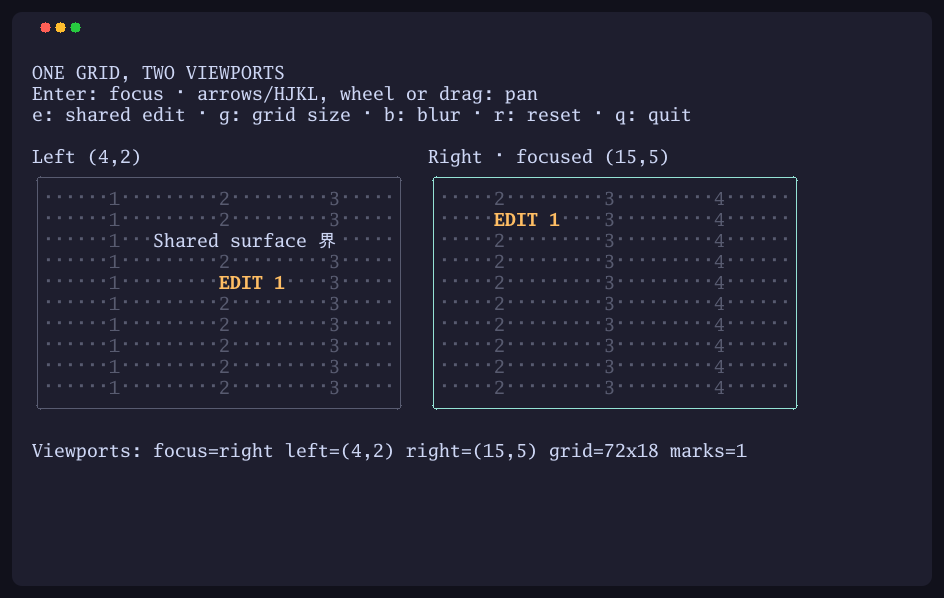

# ntcanvas

[](https://github.com/NimbleTerminal/ntcanvas/actions/workflows/ci.yml)
[](https://pkg.go.dev/nimbleterminal.dev/ntcanvas)
[](LICENSE)

`ntcanvas` lets you draw into a terminal-cell grid in Go and render any region
of it inside a Bubble Tea program. It offers three grid types, each of which
can be wrapped in a Bubble Tea `ntcanvas.Model`.

`ntcanvas.RuneGrid` stores a rune and compact terminal style per cell.
`ntcanvas.StyledRuneGrid` supports a full
[Lip Gloss style](https://github.com/charmbracelet/lipgloss#lip-gloss) per cell.
`ntcanvas.GraphemeGrid` keeps Unicode grapheme clusters together and tracks
their display widths. All three support Unicode text.

`ntcanvas.Model` adds a visible grid region and mouse/keyboard handling.
Include its rendered content in the host's `tea.View`.

[**Try the interactive browser demos**](https://nimbleterminal.github.io/ntcanvas/)

<a href="https://nimbleterminal.github.io/ntcanvas/"></a>

[View the screenshot](docs/images/viewports.png).

## Quick start

The module path is `nimbleterminal.dev/ntcanvas`; the package name is `ntcanvas`.
Choose a grid, draw into it, and wrap it in a model for viewport/input handling:

```go
import (
    "image"
    "nimbleterminal.dev/ntcanvas"
)

grid := ntcanvas.NewGraphemeGrid(80, 24)
grid.SetText(image.Pt(2, 1), "Hello 世界 👩‍💻")
model := ntcanvas.NewModel(grid, ntcanvas.WithFocus(),
    ntcanvas.WithViewWidth(40), ntcanvas.WithViewHeight(12))
content := model.View()
```

In your Bubble Tea host, retain `model, cmd = model.Update(msg)` and include
`model.View()` in the root `tea.View`. The host owns the terminal lifecycle.
Focused models support arrow keys, HJKL, and mouse-wheel panning.

## Grids

| Type | Content | Styling |
| --- | --- | --- |
| `StyledRuneGrid` | One rune per cell | Full Lip Gloss |
| `RuneGrid` | One rune per cell | Compact terminal attributes |
| `GraphemeGrid` | Graphemes with display-width tracking | Compact terminal attributes |

All implement `Surface`: `Bounds()` and `Render(rect)`. `Model` accepts any
surface and owns only viewport and interaction state. Write and resize through
the grid. Models sharing a grid see its changes but keep independent viewports.

Use checked grid constructors for external dimensions. `SetText` neutralizes
terminal controls on every grid. `StyledRuneGrid` also offers explicit
`SetRawText` for trusted legacy content. Use `GraphemeGrid` for untrusted text
in composed layouts. Rune grids do not preserve columns by default;
`SingleColumn` offers opt-in rune replacement. Grapheme widths follow Charm's
Unicode rules and can still differ from a terminal's font/policy.

See the [API guide](API.md) and [changelog](CHANGELOG.md).

## Examples

```sh
task run-minimal      # grapheme grid in a small Bubble Tea host
task run-logo         # original styled-cell canvas
task run-grids        # compare all three grids and Unicode behavior
task run-lines        # raster lines and antialiased coverage
task run-viewports    # shared grid, focus, panning, edits, and resizing
task serve-wasm-site  # browser demo at http://localhost:8000/web/
task record-demo      # record the walkthrough image above with ntrecord
```

The browser site includes Grid comparison, Lines and coverage, Shared viewports,
and the original logo. Help actions appear as buttons above the terminal.
The shared-viewports demo uses Enter to switch focus, arrows/HJKL or mouse input
to pan, **e** to edit the shared grid, **g** to resize it, and **b** to blur both
views. All demos use **q** to quit. See [example notes](examples/README.md).
Examples have a separate module; browser dependencies stay outside the library.

## Contributing

Use Go 1.27.3, [Go Task](https://taskfile.dev), Node 26, and a C compiler for race
tests. Run `task ci` for native/WASM tests, vet, builds, upstream output fixtures,
browser bridge checks, license notices, and vulnerability scans. See
[DEVELOP.md](DEVELOP.md) for setup and manual browser checks.

Contributions and feedback are welcome. Please follow our
[Code of Conduct](CODE_OF_CONDUCT.md).

- [Report an issue](https://github.com/NimbleTerminal/ntcanvas/issues)
- [Submit a pull request](https://github.com/NimbleTerminal/ntcanvas/pulls)

## Acknowledgements

Extracted from [NTCharts](https://github.com/NimbleMarkets/ntcharts).
Thanks to [Charm](https://charm.sh/) for Bubble Tea and Lip Gloss,
[bubblezone](https://github.com/lrstanley/bubblezone) for mouse zones, and
[go-booba](https://github.com/NimbleMarkets/go-booba) for the browser runtime.
Repository and site conventions follow ntpicture.

## License

[MIT License](LICENSE). Attribution is in [NOTICE.md](NOTICE.md);
dependency and browser runtime licenses are in
[THIRD_PARTY_NOTICES.md](THIRD_PARTY_NOTICES.md).

Copyright (c) 2024–2026 [Neomantra Corp](https://www.neomantra.com).

----
Made with :heart: and :fire: by the team behind [Nimble.Markets](https://nimble.markets).
